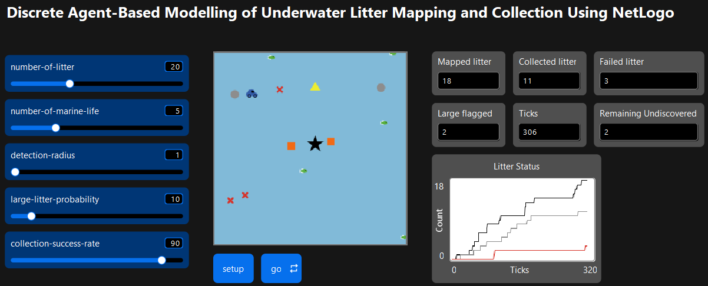

# SeaClear Discrete ABM — NetLogo

A simplified **Discrete Agent-Based Model (ABM)** of underwater litter mapping and collection inspired by the SeaClear multi-robot marine litter cleanup concept.

This NetLogo model demonstrates a small part of the proposed SeaClear workflow using a discrete grid, discrete time steps (`ticks`), and heterogeneous agents. The model focuses on litter mapping by an Observation ROV and subsequent litter collection by a Collection ROV, while also representing large litter, marine life, and a collection basket.

## Simulation Preview

> Sscreenshot of the NetLogo **Interface** tab.



## Project Context

The model is based on the same SeaClear-inspired scenario used in the broader project, but it is deliberately simplified for demonstration in NetLogo. The objective is to show how autonomous agents interact in a **discrete spatial environment** using simple local rules.

## Modelling Approach

This implementation uses **Discrete Agent-Based Modelling**.

The NetLogo world is configured as:

- a **20 × 20 patch grid**;
- a non-wrapping environment; and
- discrete-time simulation using NetLogo `ticks`.

If one patch is interpreted as approximately **2.5 m × 2.5 m**, the world represents approximately **50 m × 50 m**.

## Agents

The model contains five breeds.

### Observation ROV

The Observation ROV represents a simplified `miniTortuga`-style mapping robot.

It:

- starts near the lower-left corner;
- follows a discrete lawnmower search pattern;
- moves one grid step at a time;
- detects litter within `detection-radius`;
- changes detected litter from `undiscovered` to `on-map`; and
- pauses for the current step when marine life is within a radius of 1 patch.

The Observation ROV is displayed as a **yellow triangle**.

### Collection ROV

The Collection ROV represents a simplified `Tortuga`-style collection robot.

It:

- begins at the basket location;
- searches for mapped, normal-sized litter;
- selects the nearest eligible litter item;
- moves toward the selected target;
- attempts collection according to `collection-success-rate`;
- returns to the basket after a successful pickup; and
- pauses when marine life is within a radius of 1 patch.

The Collection ROV is displayed as a **blue car**.

### Litter Agents

Each litter object is represented as an individual turtle.

Litter begins in the state:

```text
undiscovered
```

Undiscovered litter is hidden from the Interface. When detected by the Observation ROV, litter changes to:

```text
on-map
```

Normal mapped litter is displayed as a **grey circle**.

A collection attempt can result in:

```text
on-map
   |
   +-- success --> collected
   |
   +-- failure --> failed
```

Successfully collected litter is hidden after pickup. Failed litter remains visible as a **red X**.

### Large Litter

Each litter item has a Boolean `large?` property. The percentage of litter classified as large is controlled by `large-litter-probability`.

When large litter is detected:

- it becomes visible;
- it remains in the `on-map` state;
- it is displayed as an **orange square**; and
- it is not selected by the Collection ROV.

Large litter therefore represents litter that can be mapped and flagged but is outside the simplified collection capability of this model.

### Marine Life

Marine-life agents perform a simple random walk.

At each step they:

- rotate randomly within approximately ±30 degrees; and
- move forward one patch when movement is possible.

Marine life is displayed as **green fish**.

If marine life is within one patch of either ROV, that ROV pauses for the current step.

### Collection Basket

A stationary collection basket is located at:

```text
(10, 10)
```

The basket is displayed as a **black star**. The Collection ROV returns to this location after a successful pickup.

## Litter State Model

```text
UNDISCOVERED
     |
     | detected
     v
   ON-MAP
   /    \
large?   normal
  |        |
flagged    | collection attempt
           |
        +--+--+
        |     |
     success failure
        |     |
        v     v
   COLLECTED FAILED
```

Large litter remains mapped and flagged rather than being collected.

## Discrete ABM Characteristics

This model demonstrates discrete ABM through:

- **Discrete space** — agents operate on a NetLogo patch grid;
- **Discrete time** — simulation progression uses `ticks`;
- **Discrete actions** — agents move and act step-by-step;
- **Discrete states** — litter uses `undiscovered`, `on-map`, `collected`, and `failed`; and
- **Local interaction** — the model uses neighborhood queries such as `in-radius`.

## Interface Controls

| Control | Default | Description |
|---|---:|---|
| `number-of-litter` | 20 | Number of litter agents created during setup |
| `number-of-marine-life` | 5 | Number of marine-life agents |
| `detection-radius` | 1 | Observation ROV detection radius in patches |
| `large-litter-probability` | 10 | Percentage probability that litter is classified as large |
| `collection-success-rate` | 90 | Percentage probability of a successful collection attempt |

The Interface also provides:

- **setup** — clears and initializes the model;
- **go** — repeatedly advances the simulation;
- monitors for mapped, collected, failed, flagged, undiscovered litter, and ticks; and
- a **Litter Status** plot.

## Output Monitors

The model tracks:

- `mapped-count`;
- `collected-count`;
- `failed-count`;
- `flagged-count`;
- remaining undiscovered litter; and
- elapsed `ticks`.

`mapped-count` includes every litter item that is no longer `undiscovered`, including collected, failed, and large flagged litter.

## Litter Status Plot

The `Litter Status` plot displays three time-series:

- **Mapped**;
- **Collected**; and
- **Failed**.

This provides a simple view of mission progression over simulation ticks.

## Simulation Workflow

```text
SETUP
  |
  +--> Create litter
  +--> Create basket
  +--> Create Observation ROV
  +--> Create Collection ROV
  +--> Create marine life
  |
  v
GO
  |
  +--> Observation ROV moves
  |       |
  |       +--> Detect nearby litter
  |
  +--> Collection ROV selects nearest mapped normal litter
  |       |
  |       +--> Move toward target
  |       +--> Attempt collection
  |       +--> Return to basket if successful
  |
  +--> Marine life moves
  |
  +--> Update counters
  |
  +--> Advance tick
```

The simulation stops when there is no litter remaining that is either:

- `undiscovered`; or
- normal-sized and still `on-map`.

Large flagged litter and failed litter may therefore remain visible when the simulation stops.

## Running the Model

### Requirements

- **NetLogo 7.0.4** recommended

### Open the model

Open:

```text
mns_netlogo.nlogox
```

in NetLogo.

### Run

1. Open the **Interface** tab.
2. Adjust the sliders if required.
3. Click **setup**.
4. Click **go**.
5. Observe the ROVs, litter-state changes, monitors, and plot.

## Suggested Experiments

### Detection radius

Test:

```text
detection-radius = 1, 2, 3, 4, 5
```

Possible research question:

> How does the Observation ROV detection radius affect the efficiency of litter mapping and collection?

### Litter density

Vary `number-of-litter` and compare total ticks, collected litter, failed litter, and large flagged litter.

### Collection reliability

Vary `collection-success-rate` and compare successful and failed collection outcomes.

### Marine-life density

Vary `number-of-marine-life`. Because both ROVs pause when marine life is nearby, increasing marine-life density may increase mission duration.

## Current Simplifications and Limitations

This is intentionally a small discrete ABM demonstration. It does **not** currently model:

- continuous physical motion;
- 3D underwater movement;
- hydrodynamics or currents;
- tether dynamics;
- real sonar or camera sensing;
- computer vision;
- battery consumption;
- collision physics;
- advanced path planning;
- UAV behaviour;
- USV behaviour;
- multiple Observation or Collection ROVs; or
- physical collection mechanics.

Additional implementation simplifications include:

- the Observation ROV follows a fixed discrete lawnmower pattern;
- the Collection ROV uses a nearest-target strategy;
- marine-life avoidance is represented by pausing rather than rerouting;
- successful pickup immediately changes litter to `collected`, while the ROV subsequently returns to the basket;
- the basket does not currently maintain its own deposited-litter counter; and
- large litter is mapped and flagged but intentionally excluded from collection.

These assumptions are suitable for the current task because the objective is to demonstrate a small part of the proposed system using **Discrete Agent-Based Modelling in NetLogo**.

## Repository Structure

Recommended repository layout:

```text
seaclear-netlogo-abm/
|
├── mns_netlogo.nlogox
├── docs/
│   └── images/
│       └── netlogo-interface.png
├── README.md
└── LICENSE
```

## Technologies

- NetLogo 7.0.4
- Discrete Agent-Based Modelling
- NetLogo turtles and patches
- NetLogo plots and monitors

## Authors

- Syed
- Mahendra
- Iman
- Ria
- Amirul

## Relationship to the Mesa Model

This NetLogo model represents a discrete version of a small part of the broader SeaClear-inspired simulation.

| Mesa implementation | NetLogo implementation |
|---|---|
| Continuous spatial model | Discrete patch grid |
| Continuous XY positions | Patch-based positions |
| Python | NetLogo |
| Mesa `ContinuousSpace` | NetLogo patches and turtles |
| Distance-dependent probabilistic detection | Radius-based discrete detection |
| Continuous-style movement increments | Step-based movement per tick |

The NetLogo version is intended as a compact demonstration of the same general scenario using a **Discrete ABM** approach.

## License

This project is licensed under the MIT License.

## References

- NetLogo: https://ccl.northwestern.edu/netlogo/
- Mesa: https://github.com/mesa/mesa
- SeaClear project: https://seaclear-project.eu/
